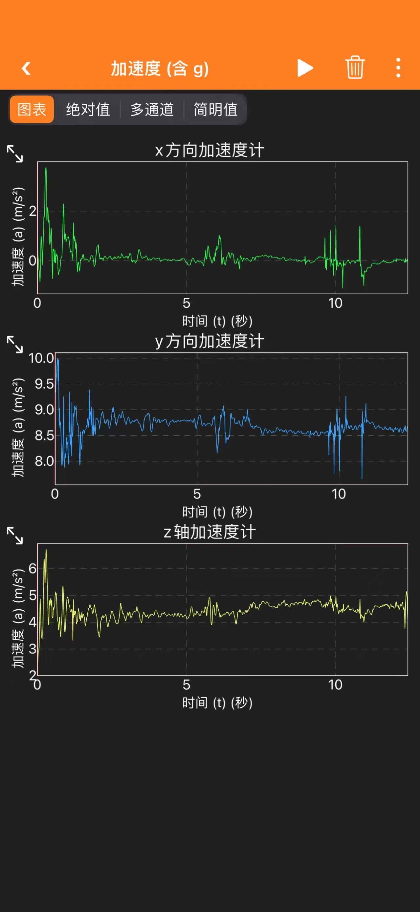
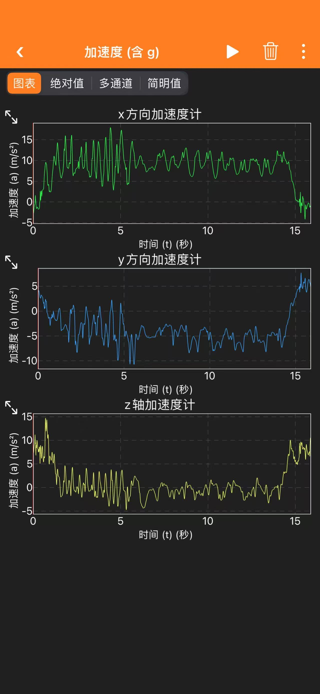
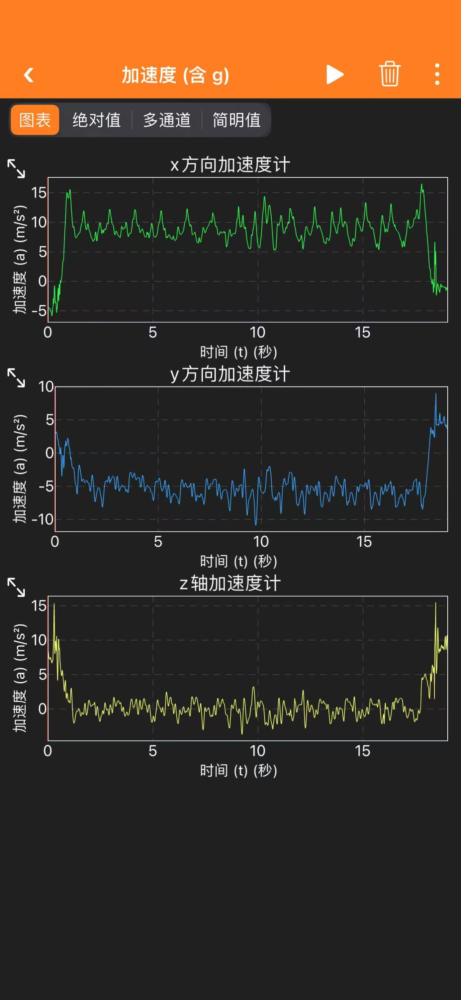
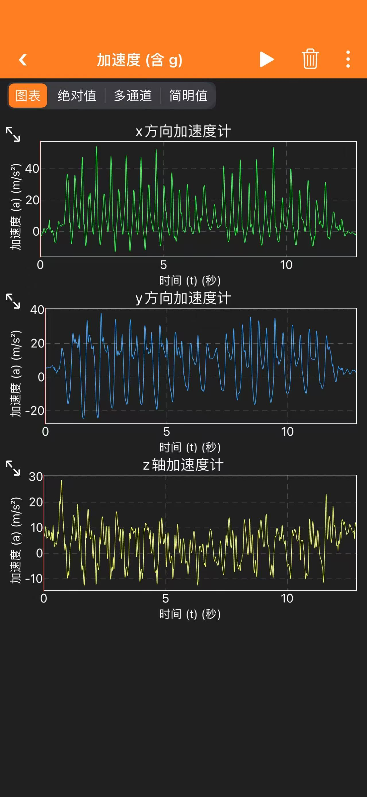
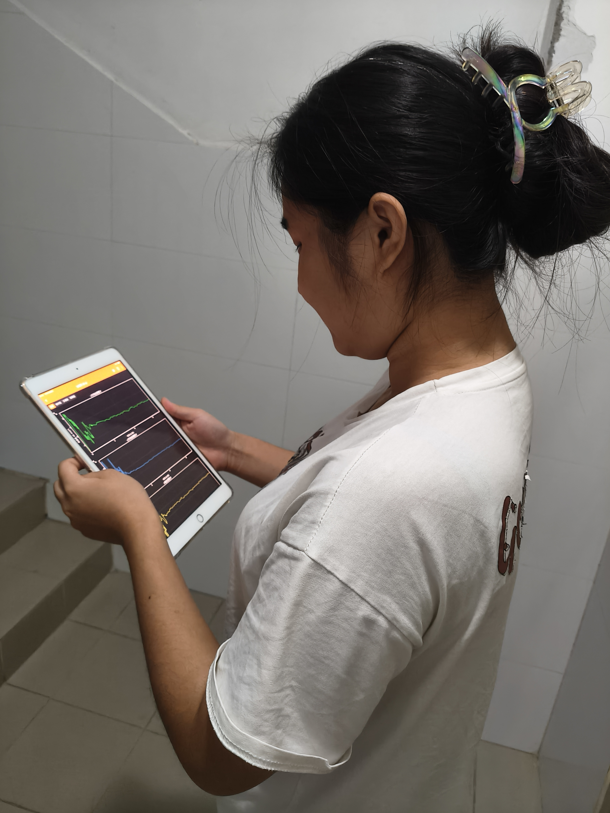
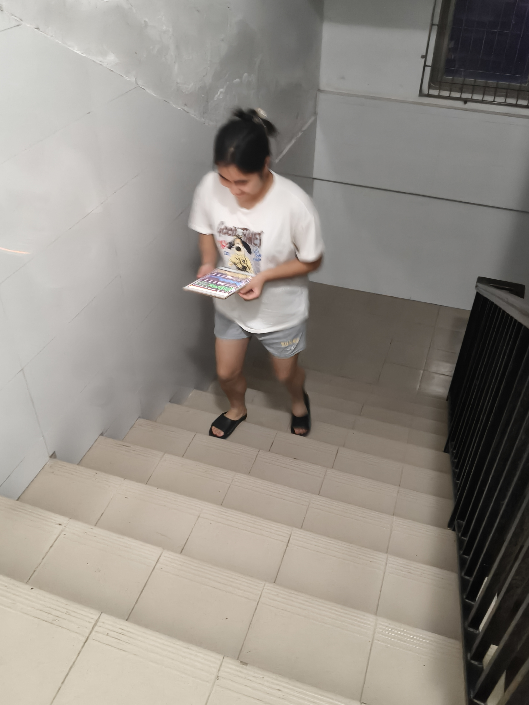
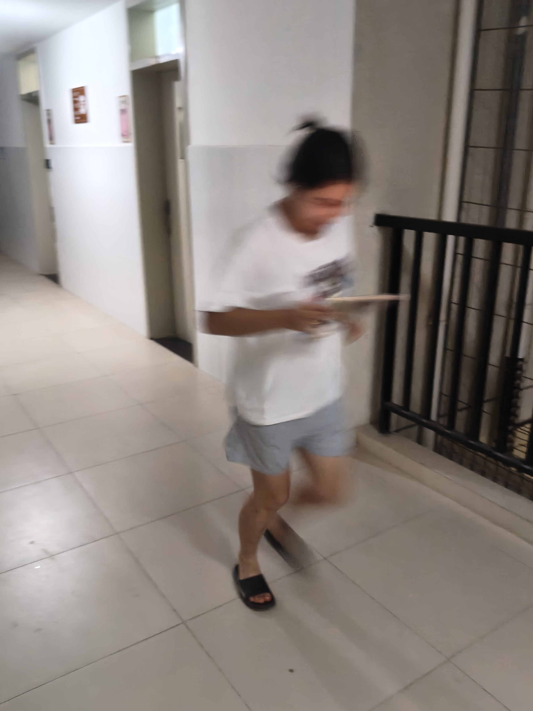
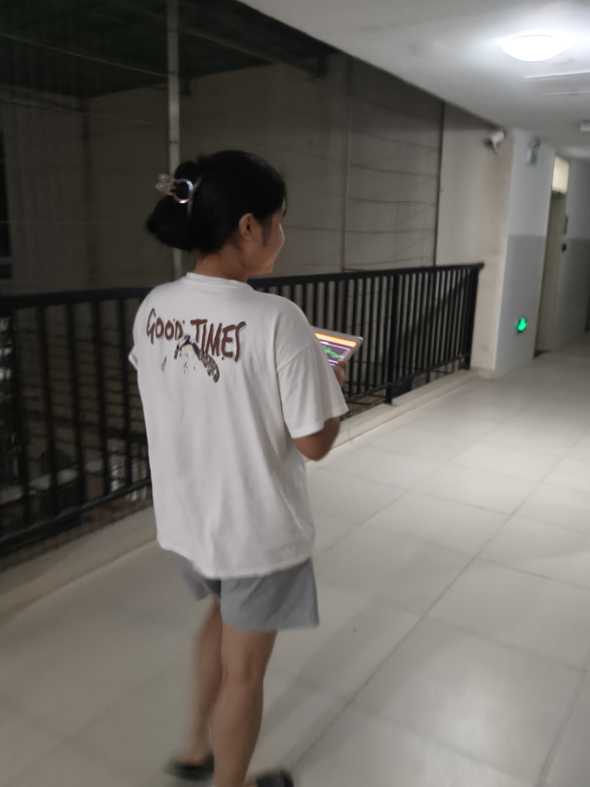

# 课题 08 · 多姿态步态加速度特征采集与对比

> 用手机传感器（Phyphox）采集平地慢走、快走、上下楼梯、静止四种状态的三轴加速度，
> 提炼可区分动作的阈值规则，并用滑窗混淆矩阵验证。

## 一、结论速览

| 结论 | 数据支撑 |
|---|---|
| 用"合加速度扣除 0.3 Hz 低通基线"得到的动态分量 $a_{dyn}$ 作统一输入，可消除手机朝向差异 | 四段录音手机倾角 63°–86° 不一致，改用合加速度后规则仍成立 |
| **静止 / 快走** 靠幅度即可 100% 分开 | $\sigma_{dyn}$：静止 ≤ 0.378，快走 ≥ 8.454，中间是空白带 |
| **慢走 / 上下楼** 幅度完全重叠，必须靠波形形状 | 幅度区间 1.23–3.32 vs 1.23–3.50，只能靠步频+峰均比+低频占比三项投票 |
| 108 个 2 s 滑窗验证，总准确率 **90.7%** | 整段多数投票 **4/4 全对** |

## 二、原始数据

| 动作 | 文件 | 时长 (s) | 样本数 |
|---|---|---:|---:|
| 静止 | `raw_data/静止/Raw Data.csv` | 12.44 | 1253 |
| 慢走 | `raw_data/慢走/Raw Data.csv` | 19.05 | 1919 |
| 快走 | `raw_data/快走/Raw Data.csv` | 12.86 | 1295 |
| 上下楼 | `raw_data/上下楼/Raw Data.csv` | 15.90 | 1602 |

- 采集工具：Phyphox 1.20，加速度含 g，导出 100 Hz 原始 CSV
- 设备：Apple iPhone 14,3（A15）/ iOS 17.2.1，实测采样率 100.7 Hz
- 每份含 `meta/device.csv`（设备信息）与 `meta/time.csv`（时间戳），可核对采样时刻
- CSV 五列：`Time (s)`、`Acceleration x/y/z`（已含 9.8 m/s² 重力分量）、`Absolute acceleration`

### 采集实况截图（自采证据）

以下四张为本人手机 Phyphox「加速度（含 g）」界面的实测截图，与上表四段 CSV 一一对应，
可作为"数据确系本人现场采集"的直接佐证。注意每张截图上的曲线形态，与后文的定量结论完全吻合。

| 状态 | 实测截图 | 截图上的辨识特征 |
|---|---|---|
| **静止** |  | 三轴基线平直，只有首尾两次手持抖动尖峰；无周期性结构 |
| **上下楼** |  | x 轴 +8 m/s² 持续偏置 + 周期约 0.7 s 锯齿节律；y 轴全程为负（身体前倾、重力分量重分配） |
| **慢走** |  | x 轴摆幅仅 ±12，节律平缓、台阶感弱；z 轴几乎贴在 0 附近 |
| **快走** |  | x 轴摆幅冲到 ±40 m/s²，节奏明显快于慢走（>1.6 Hz）；三轴同步大幅摆动 |

> 图片可直接点开看原图。`photos/` 下同名文件即上述截图，未做任何裁切或增强处理。

### 本人现场同框照（同框认证）

下面四张拍摄于采集当天，地点为教学楼楼梯间与走廊，**本人与测量设备同框**，与上表四段数据逐一对应，
满足大纲阶段一"本人现场同框照片"的要求。

| 状态 | 现场同框照 | 场景 |
|---|---|---|
| **静止** |  | 楼梯间侧位站立，双手持设备，曲线处于基线状态 |
| **上下楼** |  | 站在楼梯踏步上，对应上下楼数据段 |
| **慢走** |  | 走廊平地行走，手持设备 |
| **快跑** |  | 走廊加速跑动，画面因速度产生运动模糊 |

- 拍摄设备：**OPPO Reno13**（照片 EXIF 中保留机型，其中 2 张含 GPS 标记）
- 测量设备：画面中手持的平板运行 Phyphox「加速度（含 g）」实时界面
- 场景与数据动线一致：楼梯间对应上下楼段，走廊对应平面慢走/快跑段

> **术语说明**：题库第 08 题要求的状态写作「**快跑**」，本项目数据目录与脚本沿用采集当时的命名
> 「快走」（`raw_data/快走/`、`photos/03-快走.jpg`）。该段实测步频 **149 步/分**、
> 动态峰峰值 **59.15 m/s²（≈6 g）**，属跑动强度而非步行，实质对应题库的「快跑」项。
> 目录名未做改动，以免破坏脚本路径与图表标签的一致性。

## 三、判定流程

```
输入 2 s 窗（200 点 @100 Hz）
    ↓  a_dyn = |a| − LP₀.₃Hz(|a|)        ← 扣除重力
① σ_dyn < 0.5 且 PP < 3.0 ?   ──是──→ 静止
    ↓否
② σ_dyn ≥ 5.0 或 PP ≥ 25 ?    ──是──→ 快走
    ↓否
③ 三项投票（步频>100、峰均比<2.5、低频占比<0.26），≥2 票 → 上下楼，否则 → 慢走
```

阈值取"相邻两类实测边界的中点"或空白带中部，而不是取某一类极值——换人换机重测时不易崩。

## 四、滑窗级混淆矩阵（108 窗 / 总准确率 90.7%）

| 真实 \ 判定 | 静止 | 慢走 | 快走 | 上下楼 | 召回 |
|---|---:|---:|---:|---:|---:|
| 静止 | **22** | 0 | 0 | 0 | 100.0% |
| 慢走 | 0 | **29** | 0 | 6 | 82.9% |
| 快走 | 0 | 0 | **22** | 0 | 100.0% |
| 上下楼 | 0 | 4 | 0 | **25** | 86.2% |

误判全部集中在慢走 ↔ 上下楼，且随机分布，属两类特征本质重叠，不是边界设置问题。
与数据驱动方法对照：深度 3 决策树自动分裂出的主分界为 `峰均比 ≈ 2.43`，与人工规则 2.5 几乎一致。

## 五、必须承认的局限

1. **单人单次采样。** 每类只有 1 段录音（13–19 s），阈值对"本人+本机+本握持姿势"过拟合。
2. **"快走"段幅度异常偏大。** 合加速度均值 19.79 m/s²、峰峰值 59.15 m/s²（≈6 g），远超正常快走（一般 $\sigma_{dyn}$ 2–4）。该段更接近"手持大幅甩臂/慢跑"，因此判据 ② 的阈值 5.0 偏保守，换人实测可能需下调到 3.0 左右。**这是本份数据最需要复核的一点，已在原文中标红。**
3. **握持姿态未统一**（静止 63°、慢走 86°），故规则弃用全部单轴特征。
4. **上/下楼未拆分**，若要区分需引入重力投影在设备坐标系的漂移方向。
5. 静止段步频是被噪声触发的荒谬值，所以判据 ① 必须先拦掉静止，顺序不能颠倒。

## 六、文件清单

| 路径 | 说明 |
|---|---|
| `raw_data/{静止,慢走,快走,上下楼}/` | 4 份原始 CSV + meta |
| `photos/01-上下楼.jpg` … `04-静止.jpg` | 采集现场照片 |
| `figures/图1_四动作波形对比.png` | 时域波形：合加速度 + 动态分量 |
| `figures/图2_功率谱对比.png` | 动态分量功率谱（Welch），标 1.2–3.5 Hz 步行带 |
| `figures/图3_特征可分性.png` | 幅度 vs 形状二维散点，含阈值线 |
| `figures/图4_滑窗特征箱线图.png` | 各特征四类分布，阈值上下界依据 |
| `figures/图5_判定流程与混淆矩阵.png` | 流程图 + 90.7% 混淆矩阵 |
| `analysis/analyze.py` | 全流程复现：特征计算 + 规则判定 + 出图 |
| `analysis/predict.py` | 判定器：`python predict.py "新数据/Raw Data.csv"` |
| `analysis/特征统计表.csv` | 整段录音级特征 |
| `analysis/2秒窗特征分布.csv` | 108 个滑窗的全部特征与判定结果 |
| `analysis/规则验证结果.csv` | 混淆矩阵原始计数 |
| `动作区分规则文档.md` | 完整技术文档（含推导与物理归因） |

## 七、复现

```bash
cd analysis
python analyze.py      # 特征 + 规则 + 5 张图
python predict.py "../raw_data/快走/Raw Data.csv"
```
