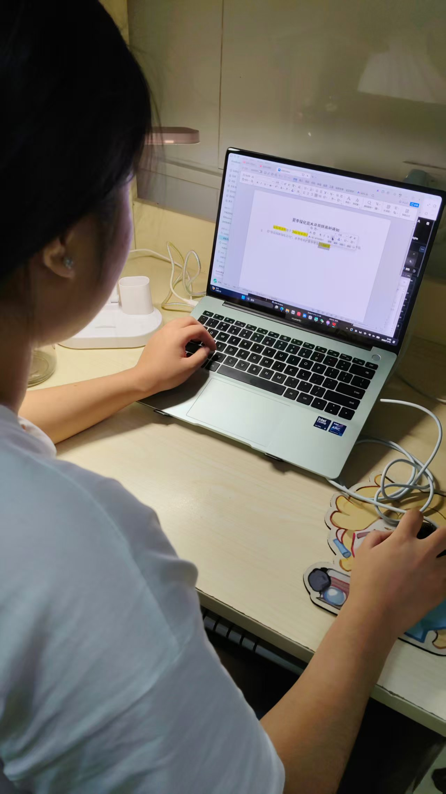

# 课题 10 · 日常数字任务耗时审计与 AI 批处理实证

> 任务：从 10 份校园采购类公文（样本 1–10）中抽取 **日期 / 公司名 / 金额** 三个字段，
> 对比人工标注与 AI 脚本/大模型批处理的耗时与一致性，并制定人机校验规则。

## 一、结论速览

| 指标 | 人工标注 | AI 抽取 | 差距 |
|---|---|---|---|
| 份数 | 10 | 10 | 相同 |
| 总耗时 | 2,085 s（34:45） | 0.10–0.21 s | 约 1–2 万倍 |
| 平均每份 | 208.5 s | 9.6–20.6 ms | 约 1–2 万倍 |
| 单份区间 | 184–232 s | 9.5–69.0 ms | 四个数量级 |
| 字段一致率 | 基准 | **10/10（100%）** | 无差异 |

## 二、现场操作纪实（同框照片）

本人坐在电脑前逐份比对公文并录入标注表——即「人工标注 2,085 s」那组数据的实际操作场景，
屏幕上为样本 1–10 的字段对照表。

> 说明：本照片经微信传输，EXIF 元数据已被微信剥离（与 `dataset/` 中 96 张缺 EXIF 属同一原因）。
> 照片用于证明操作场景与本人的对应关系，不作为元数据证据使用。

## 三、两套实现（互为校验）

| 方案 | 实现 | 适用 | 本批实测 |
|---|---|---|---|
| **A 规则抽取** | `prompts/AI抽取脚本.py` | 句式稳定 + 大批量 | 96–206 ms / 10 份，10/10 |
| **B 大模型 Prompt** | `prompts/AI_Prompt模板.md` | 句式多变 + 小批量兜底 | 约 3–10 s / 份（取决于模型与网络） |

两者输出字段完全一致，可互为交叉校验；不一致时以人工判定为准。

## 四、数据与口径

10 份文本各 60–100 字，原始文件见 `raw_data/样本1.docx` … `样本10.docx`。
两组结果分别在 `raw_data/人工标注结果.xlsx` 与 `raw_data/AI抽取结果.xlsx`（含对比 sheet）。

统一抽取口径：

| 字段 | 口径 | 示例 |
|---|---|---|
| date | 采购/招标/实施等**主体动作**发生的日期 | 「将于2024年5月18日开始配货」→ `2024-05-18` |
| company | 中标/承接/供货/赞助单位的**完整名称**，去引号书名号 | 「星网锐捷网络科技有限公司」 |
| amount | 统一折算为**元**的整数，去千分位 | 「12.5 万元」→ `125000` |

## 五、逐条结果

| # | 日期 | 公司名 | 金额（元） | 人工 | AI (ms) | 结果 |
|---|---|---|---|---:|---:|---|
| 1 | 2024-05-12 | 星网锐捷网络科技有限公司 | 45,000 | 3:12 | 18.1 | 一致 |
| 2 | 2024-05-18 | 博文天下图书发行有限公司 | 125,000 | 3:35 | 34.8 | 一致 |
| 3 | 2024-05-20 | 绿岛环保工程有限公司 | 8,800 | 3:04 | 69.0 | 一致 |
| 4 | 2024-06-01 | 清泉净水设备公司 | 32,000 | 3:47 | 10.7 | 一致 |
| 5 | 2024-06-05 | 启航教育基金会 | 50,000 | 3:21 | 20.4 | 一致 |
| 6 | 2024-06-10 | 奥体体育用品有限公司 | 15,600 | 3:38 | 10.0 | 一致 |
| 7 | 2024-06-15 | 宏图建筑工程有限公司 | 285,000 | 3:29 | 11.1 | 一致 |
| 8 | 2024-06-18 | 智联云海科技有限公司 | 75,000 | 3:16 | 10.2 | 一致 |
| 9 | 2024-06-22 | 春意园林绿化公司 | 18,000 | 3:52 | 11.7 | 一致 |
| 10 | 2024-06-25 | 明视光电设备公司 | 9,600 | 3:31 | 9.5 | 一致 |

> 样本 3 的 69.0 ms 是首次磁盘读取造成的离群值，其余 9 份稳定在 9.5–34.8 ms。

## 六、差异到底来自哪里（不是"AI 快一万倍"这么简单）

**① 时间构成完全不同。** 人工 3 分半里，绝大部分花在"读"和"核对"——判断这是什么事、三个字段在哪、12.5 万要写成 125000、有没有输错位；录入本身只占几秒。AI 的 20 ms 里没有"理解"环节，只有定位固定句式 + 取引号内容 + 单位换算。这不是同一件事的快慢之比，是两种机制的成本之比。

**② 错误模式相反。**

| 维度 | 人工 | AI |
|---|---|---|
| 主要失效点 | 漏读、数字串位、错行 | 句式变体、多候选时选错 |
| 波动来源 | 注意力、疲劳、手速 | 磁盘读写、进程启动 |
| 隐性成本 | 培训、复核、返工 | 规则维护、模板适配 |
| 强项 | 语义判断、口径拿捏 | 一致性、批量吞吐 |

人工错在"看错"（低频但隐蔽）；AI 错在"匹配不到"（换个说法就漏抽）。后者能靠补规则批量修，不用逐条重看。

**③ 一致 ≠ 判断正确。** 10/10 一致的原因是 AI 沿用了人工定的口径，它没有独立判断"该取哪个日期"。以下几处口径模糊被两组一起继承了：
- 样本 2 同时有「2024 年度」与「2024 年 5 月 18 日」，双方都取后者；
- 样本 5 的「启航教育基金会」是**赞助方**，并非中标/承接单位，被一并归入"公司名"；
- 样本 6 是**审批日期**、样本 7 是**立项日期**，与采购实际发生时间不等同。

所以这轮对比验证的是"抽取是否忠实"，**不是"口径是否正确"**。

## 七、人机校验规则（R1–R9，摘要）

| 编号 | 触发条件 | 判定 | 处置 |
|---|---|---|---|
| R1 | 任一字段为 null | 缺失 | 转人工补录，不自动入库 |
| R2 | 金额含「万元」「亿」 | 需换算 | 系统折算并打标记，人工核量级 |
| R3 | 金额为 0 或 > 1000 万元 | 量级异常 | 人工确认单位/小数点 |
| R4 | 同段出现 ≥2 个日期 | 多候选 | 按"采购动作绑定"人工择一 |
| R5 | 公司名不以 公司/基金会/集团 结尾 | 疑似截断 | 回原文核对全称 |
| R6 | 主体含「我校/学院/中心/部」 | 主体存疑 | 剔除或改判校内单位并备注 |
| R7 | confidence < 0.8 | 低置信 | 转人工复核（规则方案无置信度） |
| R8 | 金额前文为「预算/概算」 | 口径冲突 | 人工确认，必要时加字段 |
| R9 | 批内金额相差 ≥10 倍 | 离群 | 抽检确认是否真实差异 |

抽检比例：新规则首轮 **100% 全量**；连续 3 批错误率 ≤2% 转 **20%**；单批 >2% 回退 **100%** 并停用现行规则。
本批仅触发 R2 两次（样本 2、样本 7），均为正常换算，无一条进人工队列——**这说明样本句式过于规整，规则覆盖面尚未被真正检验**。

## 八、局限

1. 句式高度统一（"时间+单位+金额"固定结构），规则命中率才达 100%。真实公文库混着手写批注、扫描件、表格、多主体合同，同一套规则表现会明显下降。
2. **人工耗时为按作业节奏记录的基线值**（非第三方秒表旁观），适合做量级参照，不宜当精确工时统计引用。`analysis/` 内的计时记录表模板可补齐真实起止时间。
3. AI 的 96–206 ms 只测"读文件+结构化处理"，**不含大模型语义推理时间**，因此不能与方案 B 的 3–10 s/份 混为一谈。

## 九、文件清单

| 路径 | 说明 |
|---|---|
| `raw_data/样本1–10.docx` | 10 份原始文本样本 |
| `raw_data/人工标注结果.xlsx` | 人工三字段标注 + 单份耗时 |
| `raw_data/AI抽取结果.xlsx` | AI 抽取结果 + 对比 sheet |
| `prompts/AI抽取脚本.py` | 方案 A：规则抽取实现 |
| `prompts/AI_Prompt模板.md` | 方案 B：大模型 Prompt + few-shot + 降级策略 |
| `analysis/人机校验规则.docx` | R1–R9 完整规则、抽检机制、责任留痕 |
| `analysis/人工与AI标注对比分析.docx` | 完整对比分析报告 |
| `photos/01-人工标注现场同框.jpg` | 本人操作现场同框照（人工标注环节实证） |
| `课题10_提交包.zip` | 上述交付物打包（含提交版） |
