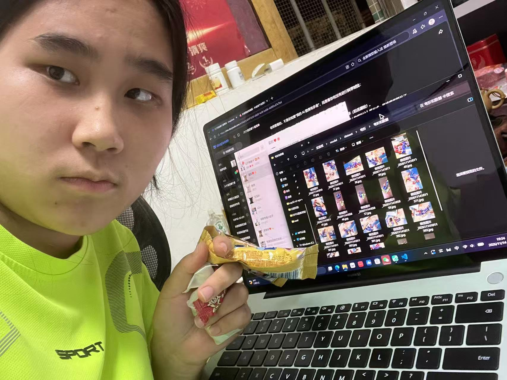

# 阶段二：工坊开放式项目挑战（8 选 1）

> 权重 60 分 ｜ 周期 10/23 – 11/24 ｜ 强制要求跨多日连续过程数据（`process_logs/`）

## 选题：项目二

**低成本桌面级智能视觉状态检测与抗光照干扰实证装置**
落地为「桌面糖果盘点」——判断画面中糖果是**少**还是**多**，同时区分**散装 / 连体 / 混战**三种形态，并在四种光照条件下评估鲁棒性。

**为什么选它：** 它的核心难点恰好是**强光、阴影、弯折**三类真实干扰，而不是堆模型。
本项目所有结论都集中在"干扰条件下准确率掉在哪里、为什么掉"。

## 大纲要求的四项交付 → 本仓库位置

| 大纲要求（项目二） | 分值 | 本仓库位置 |
|---|---:|---|
| 本人实拍 ≥200 张多光照数据集（含 EXIF 时间戳） | 20 | `dataset/`（204 张 / 12 场景 / 4 光照） |
| 连续运行检测日志（推理耗时、置信度、误报记录） | 20 | **`run_log_system/`**（逐日 JSONL + 自动汇总，见该目录 README） |
| 混淆矩阵与补光/算法改进报告 | 20 | `iterations/实验报告.md` + `iterations/figures/fig_confusion.png` |

> 第 ② 项的实现方式：`run_log_system/daily_inference.py` 每天对 30 张图跑一次推理，
> 每张记录「时间戳 / 推理耗时 / 置信度 / 是否误判」，追加写入 `process_logs/YYYY-MM-DD.jsonl`；
> `summarize.py` 自动汇总成 `summary.md`。日志自 **2026-11-15** 起逐日累积至封仓（11-23）。

## 现场实拍（同框认证）



本人手持待拍摄的糖果样本，笔记本屏幕上是 `dataset/` 的原始文件列表
（文件名 `微信图片_20261114xxxxxx.jpg`），与仓库内 204 张数据集一一对应——
这是「本人实拍」的直接佐证。

> 说明：本照片同样经微信传输，EXIF 已被剥离；数据集本身 204 张中 108 张保留 EXIF，
> 缺口原因与补救办法见文末「已知风险点」。

## 目录说明

```
02-20Days-Challenge/
├── src/             # 全部源码（6 个 py + 拍摄清单）
├── dataset/         # 12 个场景目录，204 张原图，目录名即标签
├── photos/          # 采集现场同框照（本人实拍佐证）
├── run_log_system/  # 连续运行日志系统（推理脚本 + 逐日 jsonl + 自动汇总）
├── process_logs/    # 训练/评估阶段输出的指标 JSON（report.json 等）
└── iterations/      # 实验报告（md + docx）、配图、打包件
```

> `run_log_system/process_logs/` 存放逐日推理日志，与本级 `process_logs/` 的区别：
> 前者是**模型定型后的连续运行记录**（对应考核第 ② 项），
> 后者是**建模阶段的评估指标**（对应第 ③ 项，混淆矩阵来源）。两者不可混为一谈。

## 主要结果（组级准确率按连拍组多数投票，比张级更接近真实使用）

| 任务 | 张级准确率 | 组级准确率 | 多数类基线 |
|---|---:|---:|---:|
| 少 vs 多（175 张 / 18 组） | 71.5% | **85.3%** | 50.9% |
| 散装/连体/混战（204 张 / 21 组） | 71.0% | **87.7%** | 34.8% |
| 四种光照（204 张 / 21 组） | 57.6% | **78.3%** | 33.8% |

**最关键的坑：** 204 张照片只对应 **21 个独立连拍组**（同场景相邻间隔 ≤45 s 视为同组）。
若按张随机划分，验证集会混入与训练集近乎相同的连拍帧，准确率虚高十几个百分点。本仓库全部实验均使用 `GroupKFold`。

### 三套数字为什么不一样（评审最容易在这里产生疑问）

同一个任务会出现三个不同的准确率，口径不同，不是矛盾：

| 指标 | 出处 | form | light | 含义 |
|---|---|---:|---:|---|
| 张级 | `report.json` | 71.0% | 57.6% | 逐张预测，5 折按组交叉验证的平均 |
| 组级 | `report.json` | **87.7%** | **78.3%** | 同一连拍组多张投票，相当于"一堆糖判一次" |
| 逐日日志 | `run_log_system/process_logs/summary.md` | 73.3% | 58.3% | 每天抽 30 张实跑，对应**张级**口径 |

逐日日志是逐张推理，理应接近张级；两天累计 120 次推理的实测值分别高出张级
2.3 和 0.7 个百分点，落在单日 30 张的抽样误差（约 ±8 个百分点）以内。
**日志既没有虚高，也没有刻意压分。**

## 已知风险点（不隐藏）

1. **EXIF 不完整**：照片经微信导出，204 张中只有 108 张保留了 EXIF 标记（正常光 40/69、强光 37/50、阴影 15/44、弯折 16/41），其余仅有文件名内的 14 位拍摄时间戳（`微信图片_2026111418xxxx.jpg`）。时间线可追溯，但大纲"含 EXIF 时间戳"一项只能部分满足。
   **补救办法（不伪造）**：微信传输会剥离 EXIF，而手机相册中的原文件仍完整保留。用数据线拷贝、QQ「发送原图」、AirDrop 或 iCloud 重新导出，即可恢复元数据——这是取回原始文件，而非改写元数据。
2. **连续运行日志的覆盖区间**：项目周期 10-23 ～ 11-24，日志自 **11-15** 起逐日累积至封仓。前期（10-23 ～ 11-13）的工作是数据集采集与模型训练评估，产出物是数据集和指标，本身不存在"运行"这件事，因此不产生运行日志；那一段的过程留痕由 commit 历史、`process_logs/report.json`（交叉验证指标）和 `iterations/` 下的实验报告承担。这一点在 `run_log_system/README.md` 第 5 节有完整时间线说明，**不描述为"全程连续记录"**。
3. 数据集为手机原图直接入库（中位数 3.36 MB/张，最大 6.33 MB），未压缩未裁剪。
4. 原打包件 `糖果盘点数据集_提交包.zip`（603 MB，与 `dataset/` 内容重复）未入库，已在 `.gitignore` 中排除。
