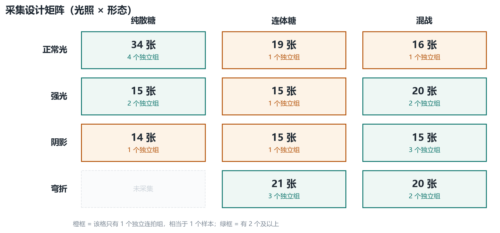
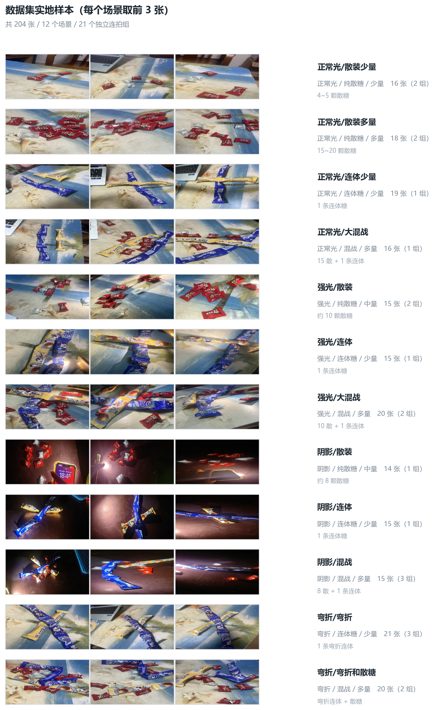
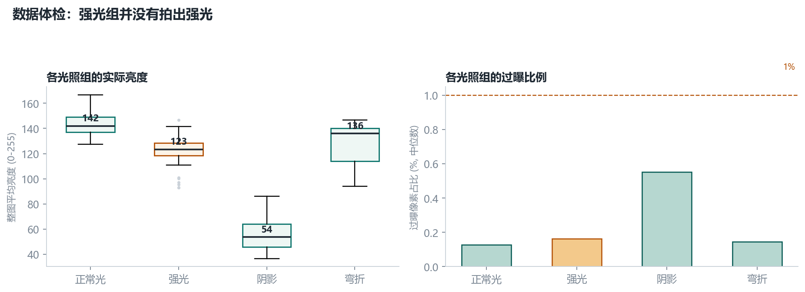
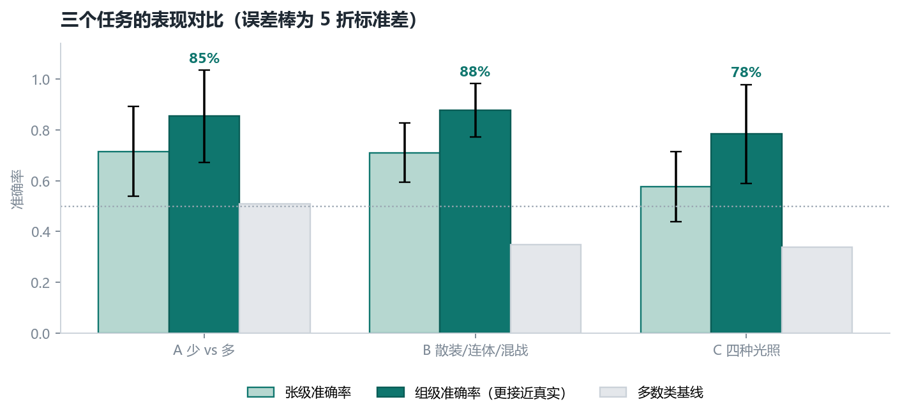
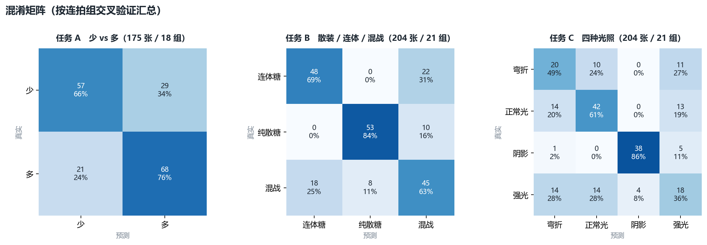

# 桌面糖果盘点数据集：构建、评估与失败分析

**数据规模** 204 张 / 12 个场景 / 21 个独立连拍组
**任务** 糖果数量（少 / 多）、形态（散装 / 连体 / 混战）、光照条件三组分类
**日期** 2026-11-14

---

## 1. 任务与目标

目标是用手机俯拍桌面糖果，自动判断**画面中糖果是「少」还是「多」**。这是盘点类应用的典型子问题：与其要求模型数出精确颗数（对标注和模型都过于苛刻），不如先回答"这堆够不够/要不要补货"。

围绕这个目标，本数据集设计了三个标签维度，构成后续三组实验：

| 维度 | 取值 | 含义 |
|---|---|---|
| `amount` | 少 / 多（+ 中量，未参与主任务） | 糖的总量档位 |
| `form` | 散装 / 连体 / 混战 | 画面上是否出现未拆开的连体糖 |
| `light` | 正常光 / 强光 / 阴影 / 弯折 | 拍摄时的光照与形变条件 |

其中 `form` 是误差的主要来源——连体糖被当成多颗独立糖，是这类任务最典型的失败模式，因此单独设为一组标签。

---

## 2. 数据集构建

### 2.1 采集设计

采用**光照 × 形态**的矩阵设计，使两个因素尽量解耦，从而能把"准确率下降"归因到具体因素上。



12 个场景按预先设定的清单拍摄，每个场景 14～21 张。设计上刻意做了两点控制：

- **控制变量**：强光组、阴影组的散装糖果数量固定在 8～10 颗，只改变光照。这样光照组的差异不会与数量差异混在一起。
- **正交覆盖**：连体糖在四种光照下都拍了一组，使模型无法把"有反光"直接当成"有连体糖"。

### 2.2 实际采集结果

| 场景 | 光照 | 形态 | 数量档 | 张数 | 独立组 | 颗数口径 |
|---|---|---|---|---|---|---|
| 正常光/散装少量 | 正常光 | 散装 | 少 | 16 | 2 | 4~5 颗 |
| 正常光/散装多量 | 正常光 | 散装 | 多 | 18 | 2 | 15~20 颗 |
| 正常光/连体少量 | 正常光 | 连体 | 少 | 19 | 1 | 1 条 |
| 正常光/大混战 | 正常光 | 混战 | 多 | 16 | 1 | 15 散 + 1 条 |
| 强光/散装 | 强光 | 散装 | 中 | 15 | 2 | 约 10 颗 |
| 强光/连体 | 强光 | 连体 | 少 | 15 | 1 | 1 条 |
| 强光/大混战 | 强光 | 混战 | 多 | 20 | 2 | 10 散 + 1 条 |
| 阴影/散装 | 阴影 | 散装 | 中 | 14 | 1 | 约 8 颗 |
| 阴影/连体 | 阴影 | 连体 | 少 | 15 | 1 | 1 条 |
| 阴影/混战 | 阴影 | 混战 | 多 | 15 | 3 | 8 散 + 1 条 |
| 弯折/弯折 | 弯折 | 连体 | 少 | 21 | 3 | 1 条弯折 |
| 弯折/弯折和散糖 | 弯折 | 混战 | 多 | 20 | 2 | 弯折 + 散糖 |

合计 204 张。全部由手机拍摄后经微信导出，文件名携带 14 位拍摄时间戳。



### 2.3 数据体检：两个必须记录在案的问题

体检不是走过场，这一步直接决定了后面哪些结论可信。

**问题一：强光组并没有拍出强光。**



| 光照组 | 平均亮度（中位） | 过曝像素占比（中位） |
|---|---|---|
| 正常光 | 142 | 0.12% |
| 强光 | **123** | **0.15%** |
| 阴影 | 54 | 0.55% |
| 弯折 | 116 | 0.13% |

强光组的平均亮度反而比正常光组**低 19**，过曝像素占比与正常光几乎相同。原因是手机测光检测到画面中的强点光源后自动压低整体曝光——拍到的不是"局部刺眼白斑"，而是"整张变暗"。这一组的标签（强光）与实际成像（偏暗）不符，第 4 节的光照分类结果会印证这一点。

**问题二：独立样本远少于照片数。**

按拍摄时间戳聚类（同场景内相邻间隔 ≤45 秒视为同一组），204 张照片只对应 **21 个独立组**，平均每组约 10 张连拍帧。其中 6 个场景只有 1 个独立组。

这带来一个直接后果：**不能按「张」随机划分训练/验证集**。同一组的 10 余帧几乎是同一画面，随机划分会让验证集里混入与训练集近乎相同的图片，准确率虚高。因此本文所有实验均按**连拍组**做分组交叉验证（GroupKFold），并同时报告两个粒度的指标：

- **张级准确率** — 按图片统计，偏乐观
- **组级准确率** — 同组预测多数投票，一组对应一堆糖，更接近真实使用

---

## 3. 方法

### 3.1 为什么用「预训练特征 + 线性分类」而不是端到端微调

数据只有 204 张、21 个独立组，而 ResNet18 有 1100 万参数。在这种规模下微调整个网络，训练集准确率能轻松到 99%，但那是记住了这 21 堆糖的样子，不是学会了判断数量。

因此主实验采用**线性探针**：用 ImageNet 预训练的 ResNet18 做一次前向，把每张图压成 512 维特征，再用带类别平衡的逻辑回归分类。理由是：

1. 参数从 1100 万降到 1025 个，与样本量匹配
2. 预训练特征已包含"圆形物体""堆叠""边缘"等通用视觉概念，正是数量判断所需
3. 整个交叉验证在 CPU 上 10 秒内完成，可反复调整实验设计

附加**水平翻转 TTA**：原图与镜像图的特征取平均，抵消手持拍摄的轻微倾斜。

端到端微调作为对照实验另跑一组（见 4.4）。

### 3.2 三个任务的样本口径

| 任务 | 定义 | 样本 | 独立组 | 说明 |
|---|---|---|---|---|
| A | 少 vs 多 | 175 | 18 | 排除"中量"（8~10 颗），因其处在两档之间，口径模糊 |
| B | 散装 / 连体 / 混战 | 204 | 21 | 全部数据 |
| C | 四种光照 | 204 | 21 | 全部数据 |

### 3.3 标签来源

无需人工标注：12 个中文文件夹名即标签，由 `labels.py` 解析出 `light` / `form` / `amount` 三个字段。这是分类任务的标准做法，零标注成本。

---

## 4. 结果

### 4.1 总体表现



| 任务 | 张级准确率 | 组级准确率 | 多数类基线 | 提升 |
|---|---|---|---|---|
| A　少 vs 多 | 71.5% ± 17.6 | **85.3% ± 18.1** | 50.9% | +34.4 |
| B　散装/连体/混战 | 71.0% ± 11.6 | **87.7% ± 10.4** | 34.8% | +52.9 |
| C　四种光照 | 57.6% ± 13.7 | **78.3% ± 19.4** | 33.8% | +44.5 |

组级准确率普遍高于张级，原因是同组内预测高度一致，投票后噪声被抵消。**标准差都在 10～19 个百分点**，说明 5 折之间的波动极大——这是 21 个独立组带来的统计噪声，不是模型不稳定。

### 4.2 混淆矩阵



**任务 A（少 vs 多）**

| | 预测少 | 预测多 |
|---|---|---|
| 真实少 | 57（66%） | 29（34%） |
| 真实多 | 21（24%） | 68（76%） |

两类错误比较对称，没有明显偏向。但"少"被误判为"多"的比例（34%）偏高，主要来自**单条连体糖**：一条 5 连包的视觉面积接近 15 颗散糖，模型倾向于判为多。

**任务 B（形态）**

| | 连体 | 散装 | 混战 |
|---|---|---|---|
| 连体 | 48（69%） | 0 | 22（31%） |
| 散装 | 0 | 53（84%） | 10（16%） |
| 混战 | 18（25%） | 8（11%） | 45（63%） |

这张表是本次实验最有价值的结果：

- **散装与连体之间零混淆**（0 / 0）——说明"画面里有没有连体糖"这个特征极其显著，模型完全抓得住
- **错误全部集中在「连体 ↔ 混战」之间**（22 + 18 = 40 张）——这正是任务的难点：单条连体糖 vs 散糖+连体糖的混合画面，两者都含连体糖，区别只在"有没有散糖"，而散糖在画面中占比很小
- 这一失败模式与课程关注的"粘连导致计数错误"完全一致，说明数据集设计是有效的

**任务 C（光照）**

| | 弯折 | 正常光 | 阴影 | 强光 |
|---|---|---|---|---|
| 弯折 | 20（49%） | 10（24%） | 0 | 11（27%） |
| 正常光 | 14（20%） | 42（61%） | 0 | 13（19%） |
| 阴影 | 1（2%） | 0 | 38（86%） | 5（11%） |
| 强光 | 14（28%） | 14（28%） | 4（8%） | **18（36%）** |

- **阴影组 86%**，几乎完美——关灯后画面亮度只有 54，与其余三组差异巨大
- **强光组只有 36%**，一半以上被判为正常光或弯折——这是 2.3 节"强光组实际亮度 123，低于正常光的 142"的直接后果。**模型没有认错，是这组数据本身就没有强光特征**

这一条同时验证了体检结论：数据质量问题会在模型指标上精确地暴露出来。

### 4.3 消融：模型到底在靠什么判断"多少"

任务 A 的 85% 看起来不错，但需要确认模型是不是真的在看"数量"。做一个消融：**只用纯散糖照片**（剔除连体与混战）做少/多分类，此时唯一的差异就是散糖颗数（4~5 颗 vs 15~20 颗）。

结果：34 张 / **4 个独立组**，组级准确率 25%，低于多数类基线 53%。

这个数字本身没有统计意义（4 个组无法做 5 折），但它清楚说明了**这批数据无法支撑「同光照、同形态下仅凭颗数区分多少」的实验**——该类样本总共只有 4 个独立场景。

因此任务 A 的 85% 应这样理解：**模型学到的是画面的"视觉总量感"**（有连体糖、有大量散糖即为多），而不是在数颗数。在业务上这个结论依然可用（混战确实糖多、单条连体确实糖少），但它不是计数模型。

### 4.4 端到端微调对照

用 ImageNet 预训练的 MobileNetV3-Small 做全网络微调（图像增强：随机裁剪、旋转 25°、颜色抖动、高斯模糊、随机擦除），输入 192×192，12 epoch，与主实验使用完全相同的分组划分：

| 方法 | 张级准确率 | 组级准确率 | 训练耗时 |
|---|---|---|---|
| 预训练特征 + 逻辑回归（主实验） | 71.5% | **85.3%** | 约 10 秒 |
| MobileNetV3-Small 全网络微调 | 73.1% | 78.3% | 758 秒 |

| 微调混淆矩阵 | 预测少 | 预测多 |
|---|---|---|
| 真实少 | 45（52%） | 41（48%） |
| 真实多 | 6（7%） | 83（93%） |

微调在张级上略有优势，但组级低 7 个百分点，且出现明显的**类别塌缩**：真实"多"几乎全对（93%），真实"少"只对一半。模型退化成了"倾向判多"的懒惰策略——因为在只有 18 个训练组的规模上，微调会迅速记住少数几个高对比度样本，而不是学到可泛化的判据。

三条折的波动也印证了这点：0.600 / 1.000 / 0.750，跨度达 40 个百分点。

结论：在 21 个独立组的规模下，**冻结特征 + 线性分类不仅快 75 倍，组级准确率还高 7 个百分点，且不出现类别塌缩**。这不是说微调不好，而是数据量不足以支撑它。若将来每组补到 20 个独立场景，微调才可能发挥优势。

---

## 5. 错误分析与局限

### 5.1 已确认的局限

| 局限 | 证据 | 影响 |
|---|---|---|
| 独立样本仅 21 组 | 每组平均 10 张连拍 | 5 折标准差达 ±18%，单折结果不可单独引用 |
| 数量与形态耦合 | 消融仅 4 组，无法分离 | 任务 A 学到的是视觉总量感，非计数 |
| 强光组不成立 | 亮度 123 < 正常光 142 | 光照分类中强光仅 36%，"抗反光"能力未被验证 |
| 无精确颗数标签 | 目录名只到档位 | 无法训练计数回归，无法计算 MAE |
| 背景为蓝白花纹桌布 | 见样本图 | 与蓝色糖果包装撞色，边缘依赖纹理而非形状 |
| 单桌子、单机位、单光源 | 全部照片同一环境 | 换场景后泛化能力未知 |

### 5.2 失败样本的具体形态

- **单条连体糖被判为"多"**：一条 5 连包的视觉面积与十几颗散糖相当，模型用面积而非颗数作判据
- **混战被判为"连体"**：散糖在画面中占比不足 15%，被当作背景噪声滤掉
- **弯折组被判为正常光**：弯折场景本身光照正常，只是糖的形状变了，光照分类器无法区分"形状变化"与"光照变化"——这属于标签设计问题，`bend` 与其他三个光照档不同质

### 5.3 如果要继续做，优先级排序

1. **每个场景补到 20 个以上独立组**（换堆、换角度、换位置），这是唯一能真正提升统计可信度的动作，比增加张数有效得多
2. **强光组重拍时锁定曝光**：点住糖果长按锁定 AE/AF，曝光补偿下调 1~2 格，直到预览中出现白斑
3. **每张记录准确颗数**，把任务从分类改成计数回归，才能评估"数错了几个"
4. **换纯色背景纸**（A3 白卡纸），消除纹理撞色
5. **改进建模**：用分割模型（如 SAM）先分割出糖，再用连通域面积估计颗数，比整图分类更接近真实计数逻辑

---

## 6. 复现方式

```bat
cd count_tool

:: 1. 校验数据集构成与连拍分组
python labels.py

:: 2. 提取预训练特征（CPU 约 50 秒）
python features.py

:: 3. 三任务交叉验证（约 10 秒）
python train_linear.py

:: 4. 生成全部配图
python make_figures.py

:: 5.（可选）端到端微调对照
python train.py --task amount --arch mobilenet_v3_small --size 192 --epochs 12 --folds 3
```

运行环境：Python 3.13 + PyTorch 2.12 (CPU) + torchvision 0.27 + scikit-learn。无需 GPU。

---

## 7. 文件说明

| 文件 | 作用 |
|---|---|
| `dataset/` | 204 张原始照片，12 个中文场景目录，目录名即标签 |
| `labels.py` | 从路径解析三维标签，并按时间戳聚类出连拍组 |
| `features.py` | 预训练 ResNet18 提取 512 维特征（含翻转 TTA） |
| `train_linear.py` | 三任务分组交叉验证，输出报告 JSON |
| `train.py` | 端到端微调对照实验 |
| `make_figures.py` | 生成报告全部配图 |
| `runs/report.json` | 全部实验指标（供复查） |
| `figures/` | 报告配图 |
| `拍摄清单.md` | 采集时的场景清单与操作要点 |
